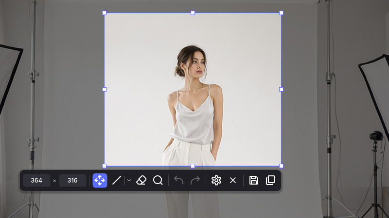
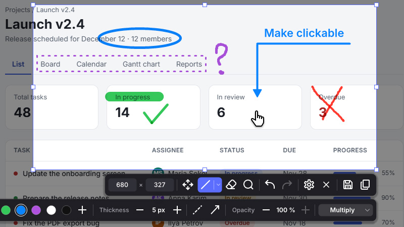
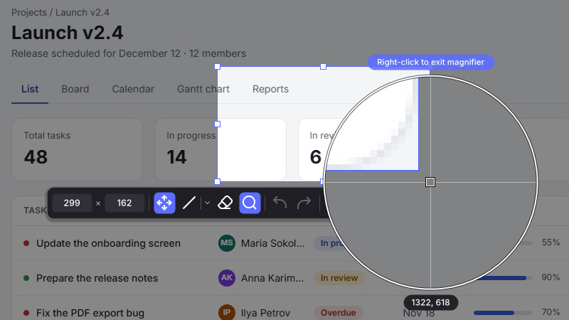
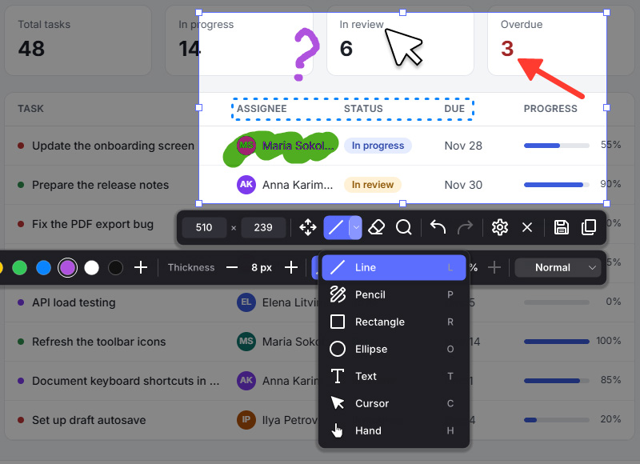
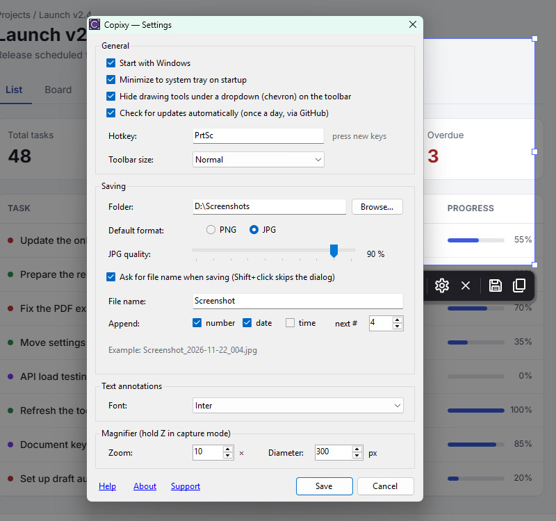

# Copixy

A small, fast screenshot tool for Windows 10/11 with annotations, a precision magnifier and pixel-exact area selection.

- One portable file — `Copixy.exe` (~700 KB), no installer.
- Runs on .NET Framework 4.8, which is built into Windows 10/11.
- Lives in the system tray. No telemetry: the only network request is an optional daily update check against GitHub (can be turned off in Settings).

  

## Download

**[⬇ Download Copixy.exe](../../releases/latest/download/Copixy.exe)** — latest version, single portable file.
All versions and release notes: **[Releases](../../releases)**.

Requirements: Windows 10 or 11 (64-bit or 32-bit). No installation needed — just run the file.

> On first run Windows SmartScreen may show "Windows protected your PC" because the file is not code-signed yet
> (see [Code signing policy](#code-signing-policy)). Click **More info → Run anyway**.

## Screenshots

**Annotate** — arrows, lines, highlighter, shapes, cursor stamps; color, thickness, opacity and blend modes.

**Magnifier** — hold Z (or use the toolbar button) for pixel-exact selection.

**Drawing tools** — click the tools button for the last tool, open the menu with ▾ or a long press.

**Settings** — hotkey, autostart, file naming, JPG quality, font, magnifier.

## Support

Copixy is free and has no ads. If it saves you time, you can support its development:

**[☕ Support on Boosty](https://boosty.to/deformarium/donate)** — one-time or monthly, by bank card.

Or send crypto directly:

| Coin | Network | Address |
|---|---|---|
| Bitcoin (BTC) | Bitcoin | `bc1q9msyefzusdugtema6jrttt7uu3n3963s0qwkdn` |
| USDT | TRON (TRC20) | `TSsUZhbw1hKHczPmtw62SPCKcV1nggNahJ` |
| SOL, USDT, USDC | Solana | `CWW3miZCCtF2LFaFUxA8NVG7azju3pwPTzqQSt9Lo3gm` |

Send each coin only on the network shown — a transfer on another network will be lost.
The same addresses (with QR codes) are in the app: **Settings → Support**. If an address in your copy of the app differs from this page, don't send — download Copixy from this repository.

## Getting started
Run `Copixy.exe` — it goes to the system tray. Take a screenshot by:
- pressing the hotkey (**PrtSc** by default, configurable in Settings);
- clicking the tray icon;
- launching the exe again (desktop shortcut, pinned taskbar icon).

> On Windows 11, PrtSc is often taken by the Snipping Tool. If Copixy shows a warning on startup, turn off
> *Settings → Accessibility → Keyboard → Use the Print screen key to open screen capture*, or pick another hotkey.

## Selecting an area
Capture starts in Move mode: select an area, then copy or save it right away.
- Drag to draw a frame with handles on the corners and sides.
- Resize by any corner, handle or side; drag inside the frame to move it.
- **Shift** — square. **Alt** — grow from the center. **Shift+Alt** — square from the center.
  Works both when creating the frame and when resizing by a corner.
- Click without dragging — select the whole monitor.
- Exact size — width and height fields on the toolbar: click, type a number, press Enter (Tab switches fields, ↑/↓ — ±1).
- **Magnifier** for precise aiming: a circle (×6, 300 px by default) around the cursor.
  Hold **Z** — release to hide it. Or click the magnifier button on the toolbar (right of the eraser) — it stays on until you right-click or press Esc; the current tool keeps working.
- **Space + drag** — move the frame with any tool active.
- Arrow keys — move the frame by 1 px (10 px with Shift); Ctrl+arrows — resize.

## Toolbar
Sticks to the bottom-right corner of the frame (Copy is the rightmost button). If it doesn't fit on screen it jumps
above the frame and/or to the left; if there's no room above or below, it goes inside the frame.

| Action | Key |
|---|---|
| Move — back to moving the frame | M (or V) |
| Move the frame with any tool | hold Space + drag |
| Drawing tools: click the icon for the last used tool; chevron ▾ or long-press for the menu (can be shown inline — see Settings). The eraser is always on the toolbar | — |
| Line / Pencil / Rectangle / Ellipse / Text | L / P / R / O / T |
| Dashed — toggle for line, rectangle and ellipse | D |
| Arrowhead — toggle for line | A |
| Cursor — drop a cursor image (S 24 / M 40 / L 64 px); drag to move, × to delete | C |
| Hand — drop a pointing-hand cursor (S / M / L); drag to move, × to delete | H |
| Eraser — erases drawings, the screenshot underneath stays intact | E |
| Erase all — remove all drawings at once (in eraser options) | Delete |
| Magnifier | hold Z, or toolbar button |
| Color: 8 presets + any color via the picker | — |
| Line thickness (shared by all shapes), eraser size | mouse wheel |
| Opacity 10–100 % (lines, pencil, shapes, text) | 1…9 = 10…90 %, 0 = 100 % |
| Blend mode: Normal, Multiply, Screen, Overlay, Soft light, Darken, Lighten, Difference | toolbar menu |
| Text size and weight (Light → Bold) | mouse wheel |
| Undo / Redo | Ctrl+Z / Ctrl+Y |
| Copy to clipboard | Ctrl+C, Enter, double-click |
| Save (PNG or JPG) | Ctrl+S; Shift+click or Ctrl+Shift+S — without the dialog |
| Settings | — |
| Close | Esc, right-click |

While drawing, **Shift** snaps lines to 45° and makes squares/circles; **Alt** draws shapes from the center.
To move the frame again, press Move (M), click the active tool again, or right-click.

**Text:** click inside the frame and type; Enter — new line; Esc, Ctrl+Enter or a click elsewhere — done.
Text stays an object: drag it (in Text, Cursor or Move mode), click it to edit, use × or Delete to remove it.

## Updates
Copixy checks GitHub for a new release about a minute after start and then at most once a day.
When a newer version is available, a tray notification appears — click it to open the download page.
You can also check manually: tray menu → **Check for updates…**. Updates are never installed automatically.
To turn the check off, uncheck *Check for updates automatically* in Settings.

## Settings
Open from the tray menu (*Settings…*) or the gear button on the toolbar.
- Start with Windows.
- Check for updates automatically (once a day).
- Minimize to the tray on startup (if off, Settings open on startup).
- Hide drawing tools under a chevron, or show them inline.
- Show or hide the "Select an area" hint that appears in the middle of the screen when a capture starts.
- Toolbar size: Normal or Compact (about 15 % smaller).
- Hotkey.
- Save folder, default format (PNG/JPG), JPG quality.
- File name: base name + number / date / time, next number, live example.
- Text font (bundled Inter by default, or any installed font).
- Magnifier: zoom (2–16×) and diameter (100–800 px).

The Settings window also has **Help** (all shortcuts), **About** and **Support** (Boosty and crypto wallets with QR codes) links.

Settings are stored in `%APPDATA%\Copixy\settings.ini`.

## Building from source
Run `build.cmd`. It builds `Copixy.exe` with the C# compiler that ships with Windows (`csc.exe` from .NET Framework) — no Visual Studio needed.

Embedded resources: icons, logos and hand cursors from `resources\icons` (except `app_*` and `Copixy-Logo-220`), cursor images from `resources\cursors`,
fonts from `resources\fonts`, and the app icon `resources\app.ico`.

Icons come in sets per button: `name_xSm.png` (16), `_Sm` (20), `_Md` (24), `_Lg` (32), `_xLg` (40), `_2xLg` (48).
The base toolbar icon size is 24 px at 100 % scaling; for other display scales the closest pre-rendered size is used.

## Code signing policy

Releases are currently **unsigned**. Code signing through the SignPath Foundation program is planned; signed releases will use
free code signing provided by [SignPath.io](https://about.signpath.io), certificate by [SignPath Foundation](https://signpath.org).

- Signed files are built only by [GitHub Actions](../../actions/workflows/build.yml) from the source code in this repository — never on a local machine.
- Every signing request is approved manually.

Team roles:

- Committers and reviewers: [Deformarium](https://github.com/Deformarium)
- Approvers: [Deformarium](https://github.com/Deformarium)

## Privacy

This program will not transfer any information to other networked systems unless specifically requested by the user or the person installing or operating it.

- **Update check** (optional, on by default, can be turned off in Settings): once a day Copixy sends one request to the GitHub API (`api.github.com`) to read the number of the latest release. Nothing about you or your screenshots is sent; GitHub sees the request like any web request (your IP address). See the [GitHub General Privacy Statement](https://docs.github.com/en/site-policy/privacy-policies/github-general-privacy-statement).
- Links in Help / About / Support (GitHub, Boosty) open in your browser only when you click them.
- Screenshots stay on your computer: in the clipboard or in the files you save.

## Licenses

- Copixy is released under the [MIT License](LICENSE).
- Toolbar icons, app icon and logo — original artwork by Deformarium, part of this project (MIT).
- Font: [Inter](https://rsms.me/inter) — [SIL Open Font License 1.1](resources/fonts/OFL.txt) (embedded, Latin + Cyrillic subset).
- Bitcoin, Tether (USDT), Solana and Boosty logos are trademarks of their respective owners and are used only to identify the payment options.
